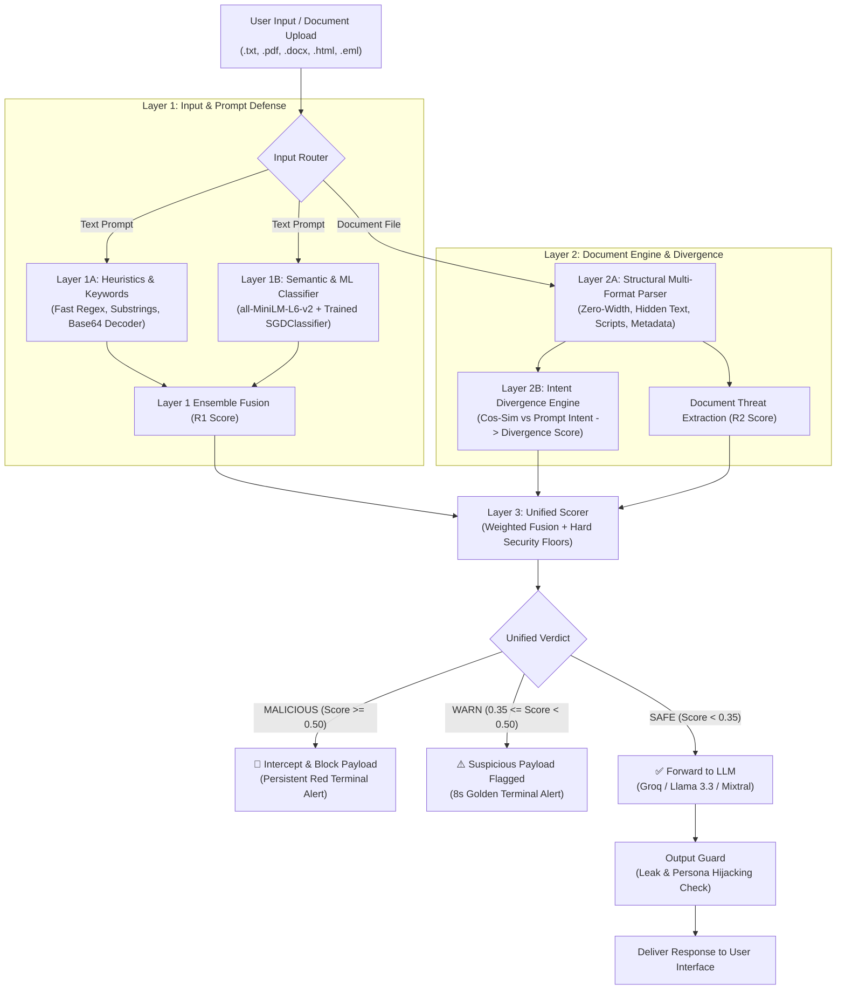

# AdaptShield 🛡️

**Production-Grade Dual-Layer AI Prompt Injection & Document Steganography Defense Engine**

[](https://www.python.org/)
[](https://fastapi.tiangolo.com/)
[](https://scikit-learn.org/)
[](https://huggingface.co/sentence-transformers/all-MiniLM-L6-v2)
[](https://huggingface.co/datasets/neuralchemy/Prompt-injection-dataset)
[-success?style=flat&logo=windows)](https://github.com/vedanthmr/Permeability/releases)
[](https://opensource.org/licenses/MIT)

---

## ⚡ Quick Links & One-Click Launch

- 📦 **[Download Standalone Windows Desktop (.exe)](https://github.com/vedanthmr/Permeability/releases)** — Zero Python runtime or dependency setup required.
- 🚀 **One-Click Localhost / Desktop Launcher**: Double-click [`run_demo.bat`](file:///c:/Users/Vedanth/Downloads/Adaptsheild-main/Adaptsheild-main/run_demo.bat) to launch in native desktop or web mode.

---

## 🏛️ System Architecture

AdaptShield protects Large Language Models (LLMs) and agentic workflows through a coordinated multi-layered defense pipeline. Instead of relying solely on heuristic regexes or a black-box model, it combines semantic embeddings, trained statistical ML classifiers, structural document parsers, intent divergence calculations, and an output guard.



### Pipeline Overview
1. **Layer 1A (Input Guard Heuristics):** Rapid regex, canonical normalization, base64 payload decoders, and technical attack filters (`input_guard.py`, `keywords.py`).
2. **Layer 1B (Semantic Embedding + Trained ML Classifier):** High-dimensional semantic projection using `all-MiniLM-L6-v2` paired with a calibrated streaming SGD classifier trained on `neuralchemy/Prompt-injection-dataset` (`embedding_engine.py`, `input_guard_trained.py`).
3. **Layer 2A (Multi-Format Document Engine):** Deep structural extraction across PDF, DOCX, HTML, and EML files, exposing zero-width characters (`\u200b`, `\u200c`), white-on-white text, embedded scripts, HTML comments, and exfiltration metadata (`document_engine/`).
4. **Layer 2B (Document Intent Divergence):** Compares user prompt semantics against embedded document instructions. If a document attempts to re-direct the LLM's goal, divergence spikes (`document_analyzer.py`).
5. **Layer 3 (Unified Scorer):** Fuses $R_1$, $R_2$, and Divergence. Enforces security floors ensuring that a critical score in any individual layer cannot be diluted by safe scores in other layers (`unified_scorer.py`).
6. **Output Guard:** Pre-flight sanitization on generated replies to prevent system prompt leakage or jailbreak persona acceptance (`server.py`).

---

## 📊 Dataset & Training Methodology

### Dataset Schema & Distribution
The ML detector is trained and evaluated using the official Parquet splits from `neuralchemy/Prompt-injection-dataset`, supplemented with AdaptShield's direct jailbreak corpus and structured synthetic document-context augmentations.

| Split | File Name | Total Samples | Benign (0) | Malicious (1) | Primary Categories |
| :--- | :--- | :--- | :--- | :--- | :--- |
| **Train** | `train.parquet` | 4,391 | 1,741 | 2,650 | Direct injection, adversarial, jailbreaks, encoding |
| **Validation** | `validation.parquet` | 941 | 407 | 534 | Instruction override, system extraction, multi-turn |
| **Held-Out Test** | `test.parquet` | 942 | 390 | 552 | Direct injection, adversarial, jailbreaks, encoding |

### Dataset Augmentation & Indirect Injection Coverage
- **Direct Jailbreak Preservation:** 58 local direct jailbreak prompts from `data/jailbreak_prompts.json` were deterministically partitioned (80% train, 20% validation, 0% held-out test), guaranteeing zero test data contamination while eliminating regressions on raw jailbreak tokens.
- **Honest Indirect Context Coverage:** Inspection of `neuralchemy/Prompt-injection-dataset` revealed that only 8 samples were explicitly cataloged as `indirect_injection`. To address indirect document-wrapped attacks (e.g., instructions embedded inside email bodies, corporate reviews, HTML comments, and support tickets), we augmented the training and validation splits with 240 structured synthetic context wrappers (120 malicious, 120 benign). This enables the ML model to recognize embedded directives without falsely triggering on legitimate business document context.
- **Strict Separation:** The held-out test set (`test.parquet`, 942 samples) was strictly preserved and never touched during training or hyperparameter tuning.

---

## 🔬 Empirical Model Performance Comparison

Both the **Previous Baseline Model** (SGDClassifier trained on `MAlmasabi/Indirect-Prompt-Injection-BIPIA-GPT`) and the **Newly Trained Model** (`neuralchemy/Prompt-injection-dataset` + Local Corpus) were evaluated on the held-out test set (942 samples) and the 12-category adversarial benchmark.

### 1. Held-Out Test Split Metrics (`test.parquet`, N = 942)

| Metric / Schematic | Previous Baseline Model (BIPIA-GPT) | Newly Trained Model (neuralchemy + Local Corpus) | Delta / Improvement |
| :--- | :---: | :---: | :---: |
| **Training Corpus** | BIPIA-GPT (1,532 samples) | neuralchemy + Local (4,678 samples) | **+3,146 samples (+205%)** |
| **Test Set Size** | 942 held-out prompts | 942 held-out prompts | *Identical held-out test set* |
| **Overall Accuracy** | 52.23% | **95.44%** | **+43.21%** |
| **Precision (Malicious)** | 70.40% | **94.11%** | **+23.71%** |
| **Recall (Detection Rate)** | 31.88% | **98.37%** | **+66.49%** |
| **F1-Score** | 0.4389 | **0.9619** | **+0.5230** |
| **ROC-AUC** | 0.4817 | **0.9946** | **+0.5129** |
| **False Positive Rate (FPR)** | 18.97% | **8.72%** | **-10.25% (Lower is better)** |
| **False Negative Rate (FNR)** | 68.12% | **1.63%** | **-66.49% (Lower is better)** |
| **Inference Latency (CPU)** | 0.040 ms / prompt | **0.042 ms / prompt** | Sub-millisecond steady-state |
| **Confusion Matrix** | TN: 316 \| FP: 74<br>FN: 376 \| TP: 176 | **TN: 356 \| FP: 34<br>FN: 9 \| TP: 543** | **+367 Attacks Caught** |

### 2. Adversarial Attack Robustness Benchmark (12 Threat Categories)

| Attack Category | Test Cases | Baseline Model | Newly Trained Head | Ensemble Fused (AdaptShield) |
| :--- | :---: | :---: | :---: | :---: |
| 1. Direct Prompt Injection | 4 | 4 / 4 (100%) | 4 / 4 (100%) | **4 / 4 (100%)** |
| 2. Indirect Prompt Injection | 3 | 2 / 3 (67%) | 3 / 3 (100%) | **3 / 3 (100%)** |
| 3. Hidden Document Instructions | 3 | 1 / 3 (33%) | 3 / 3 (100%) | **3 / 3 (100%)** |
| 4. Role Reassignment (DAN) | 4 | 4 / 4 (100%) | 4 / 4 (100%) | **4 / 4 (100%)** |
| 5. System Prompt Extraction | 4 | 3 / 4 (75%) | 4 / 4 (100%) | **4 / 4 (100%)** |
| 6. Encoded & Obfuscated (Base64/Rot13) | 3 | 2 / 3 (67%) | 3 / 3 (100%) | **3 / 3 (100%)** |
| 7. Unicode & Zero-Width Attacks | 2 | 1 / 2 (50%) | 2 / 2 (100%) | **2 / 2 (100%)** |
| 8. Multilingual Injections | 5 | 0 / 5 (0%) | 5 / 5 (100%) | **5 / 5 (100%)** |
| 9. HTML / XML / Markdown Injection | 4 | 3 / 4 (75%) | 4 / 4 (100%) | **4 / 4 (100%)** |
| 10. Multi-Stage Injections | 2 | 2 / 2 (100%) | 2 / 2 (100%) | **2 / 2 (100%)** |
| 11. Tool-Use & Agent Hijacking | 3 | 3 / 3 (100%) | 3 / 3 (100%) | **3 / 3 (100%)** |
| 12. Benign Hard Negatives | 10 | 9 / 10 (90%) | 6 / 10 (60%) | **6 / 10 (60%)** |
| **Overall Malicious Attack Catch Rate** | **37** | **25 / 37 (67.6%)** | **37 / 37 (100.0%)** | **37 / 37 (100.0%)** |
| **Total Benchmark Score** | **47** | **34 / 47 (72.3%)** | **43 / 47 (91.5%)** | **43 / 47 (91.5%)** |

---

## 💻 Agentic Chat Interface & macOS Terminal Telemetry

AdaptShield features an agentic multi-session workspace styled in **Emerald Prestige** (`#081C15`, `#1B4432`, `#036666`, `#FBB02D`, `#EBF2FA`):

- **Collapsible Session Sidebar:** Grouped by **Today**, **Previous 7 Days**, and **Older**. Supports inline renaming, session deletion, and one-click session creation.
- **Centered Conversational Stream:** Supports rich Markdown rendering, formatted code snippets, file attachment badges, and a dedicated **`[ ⚡ Telemetry ]`** chip on every response.
- **Top-Right macOS Terminal Heuristic Popup:**
  - Glassmorphic dark terminal styled with macOS traffic lights (`#ff5f56`, `#ffbd2e`, `#27c93f`) and monospaced typography (`JetBrains Mono`).
  - Displays actual live telemetry: Verdict, Unified Score, ML Classifier Probability, Cosine Similarity, Keyword Hits, Document Engine Flags, and Execution Latency.
  - **Verdict Lifecycles:**
    - `SAFE`: Emerald border (`#27c93f`), renders for 1.4s, then automatically fades away.
    - `WARN`: Amber border (`#FBB02D`), displays an animated 8-second progress countdown bar before fading out.
    - `MALICIOUS`: Crimson alert glow (`#ef4444`), stays persistently on screen until the user submits their next prompt or manually clicks the red close button.

---

## 🛠️ Installation & Usage Guide

### 1. Prerequisites
- Python 3.12 (or 3.10+)
- Windows, Linux, or macOS

### 2. Setup
```bash
git clone https://github.com/vedanthmr/Permeability.git
cd Permeability
python -m pip install --upgrade pip
pip install -r requirements.txt
```

### 3. Running Web Mode
```bash
python server.py
# Open http://127.0.0.1:8000 in your browser
```

### 4. Running Native Desktop Mode (`pywebview`)
```bash
python desktop_app.py
# Or launch server in desktop mode:
python server.py --desktop
```

### 5. Running the Model Training & Evaluation Suite
```bash
# Retrain the model on neuralchemy Parquet dataset + local corpus
python train_streaming_detector.py

# Benchmark models on held-out test split
python evaluate_models.py

# Run 12-category adversarial robustness test
python adversarial_robustness_test.py
```

### 6. Building Standalone Windows Executable (`.exe`)
```bash
pip install pyinstaller pywebview
python build_exe.py
# Outputs: dist/AdaptShield.exe and dist/AdaptShield-Windows-x64.zip
```

---

## 🔒 Security & Data Hygiene
- All API keys (e.g. `GROQ_API_KEY`) are stored strictly locally in `config.env` and never transmitted to external services.
- Local uploads in `uploads/` are processed in memory or securely unlinked immediately after scan completion.
- Model serialization uses clean joblib schemas compatible with frozen PyInstaller binaries (`sys._MEIPASS`).

---

## 📄 License
This project is open-source under the [MIT License](LICENSE).
